# Smart Parking Management & Allocation System

DBMS capstone project (Project 6) for **Database Management Systems (ETCCMS304)**, B.Tech Semester III.

A database that manages users, vehicles, parking zones and slots, reservations, dynamic slot allocation, gate entry/exit, visitor passes, violations and penalty payments. The key guarantee: **a slot can never be double-booked, even when two users request it at the same moment.**

- **Core database:** MySQL 8.0.31+ (16 normalized tables, 2 functions, 8 procedures, 9 triggers, 5 views, 6 indexes)
- **NoSQL extension:** MongoDB event log (gate and sensor events)
- **Analytics:** star schema + ETL procedure
- **Application:** Python demo with parameterised queries and a threaded concurrency test

> Author: *Anish Kumar Jha* | Roll No: *2501010273* | Course: DBMS (ETCCMS304)

## Project structure

```
smart_parking/
├── sql/
│   ├── 01_schema.sql                          DDL, constraints
│   ├── 02_functions_procedures_triggers.sql   routines, cursor, triggers
│   ├── 03_seed_data.sql                       realistic sample data
│   ├── 04_views_indexes.sql                   views, indexes, EXPLAIN
│   ├── 05_queries.sql                         21 complex queries
│   ├── 06_transactions_concurrency.sql        COMMIT/ROLLBACK/SAVEPOINT + two-session demos
│   ├── 07_security_rbac.sql                   roles, grants, SQL-injection demo
│   ├── 08_star_schema_etl.sql                 star schema + ETL
│   ├── 09_test_cases.sql                      31 tests + 4 invariants
│   └── 10_invariant_proof_queries.sql         proof queries
├── mongodb/gate_events.js                     NoSQL extension
├── app/parking_app.py                         Python integration demo
├── er_diagram.mermaid                         ER diagram (paste into mermaid.live)
├── run_all.sh                                 runs the SQL files in order
└── docs/screenshots/                          evidence screenshots
```

## How to run

1. Install **MySQL 8.0.31 or newer** (needed for `INTERSECT` / `EXCEPT`) and MySQL Workbench.
2. Run the files in this order (Workbench: File → Open SQL Script → Execute):
   `01` → `02` → `03` → `04` → `05` → `07` → `08` → `09` → `10`.
   File `02` must run before `03` because the sample data relies on the triggers.
3. If Workbench shows error 1418, run `SET GLOBAL log_bin_trust_function_creators = 1;` and rerun `02`.
4. Or from a terminal (Git Bash / Linux / macOS): `./run_all.sh root`
5. Optional: `mongosh mongodb/gate_events.js`, and `python app/parking_app.py --concurrency`.

> The passwords in `07_security_rbac.sql` are demo values for local use only. Change them for any real deployment.

## Key design points

- **Overlap rule:** two intervals conflict when `start1 < end2 AND end1 > start2`, so 10:00–12:00 and 12:00–14:00 are allowed, while 10:00–12:00 and 11:00–13:00 are not.
- **Concurrency:** each write procedure first locks the slot row (`SELECT ... FOR UPDATE`). A competing session waits, then sees the committed booking and is rejected. Dynamic allocation uses `FOR UPDATE SKIP LOCKED`, so a second user receives the next free slot.
- **Defence in depth:** the overlap check exists in a function, in the procedures, and in triggers, so even a direct `INSERT` cannot create a double booking.
- **Security:** four roles with least privilege; procedures run with definer rights; parameterised queries stop SQL injection.
- **Normalization:** 3NF/BCNF. For example, `user_id` is not stored in `reservation` because the booker is always the vehicle owner (a transitive dependency).

## Evidence (screenshots)

### Schema created
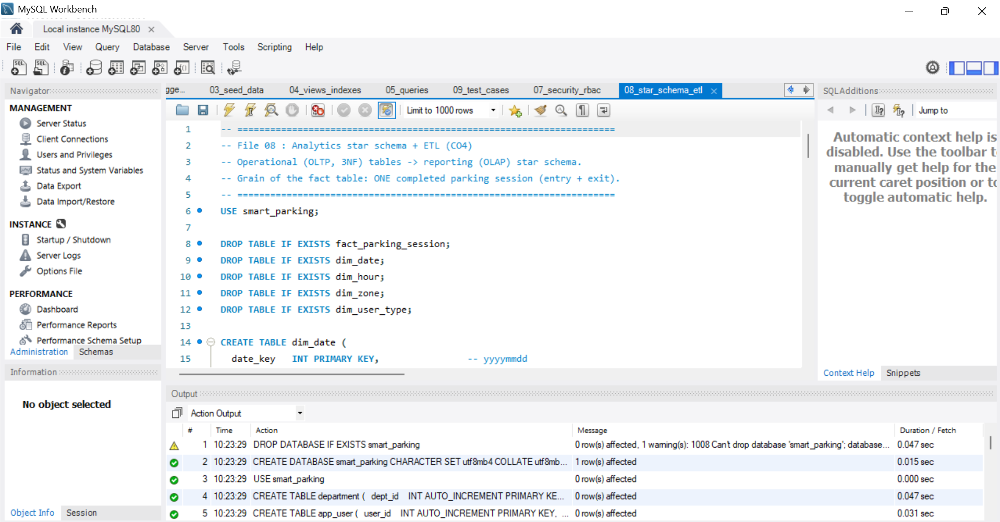

### Two sessions, same slot: overlap rejected
Session A books 10:00–12:00 and succeeds.
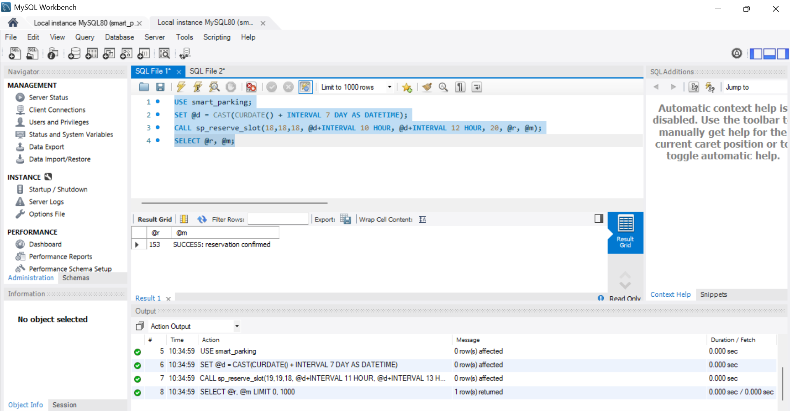

Session B requests 11:00–13:00 and is rejected.
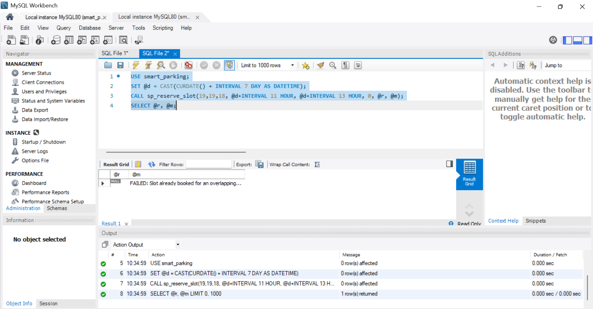

Session B waited about 25 seconds on the slot lock before failing, which proves the row lock.
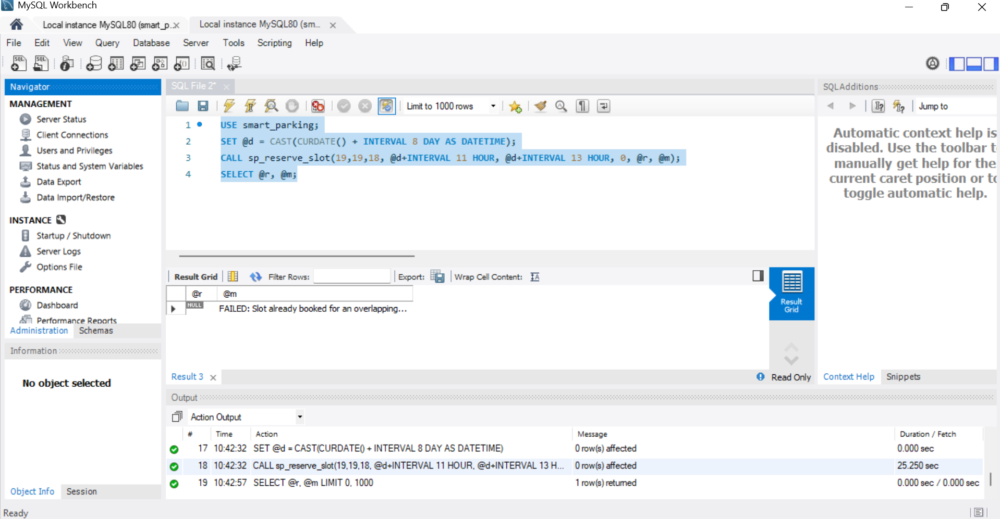

### Business rule: 10–12 booked, 11–13 rejected, 12–14 accepted
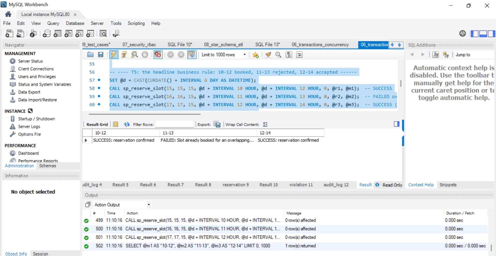

The resulting data on slot 15 contains no overlapping booking:
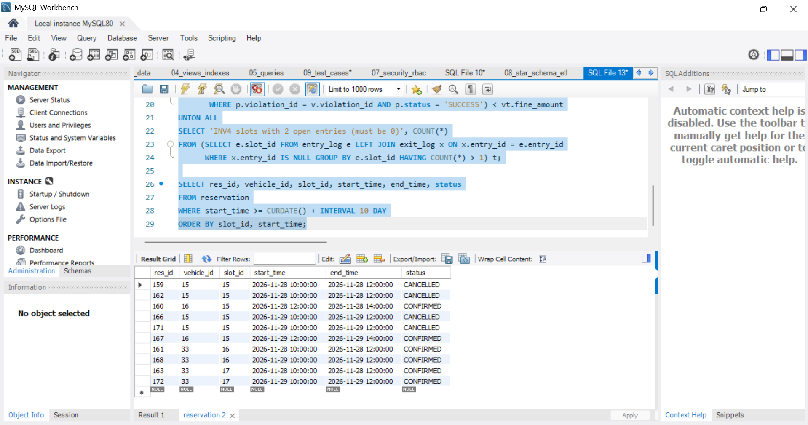

### Complex SQL queries (file 05)
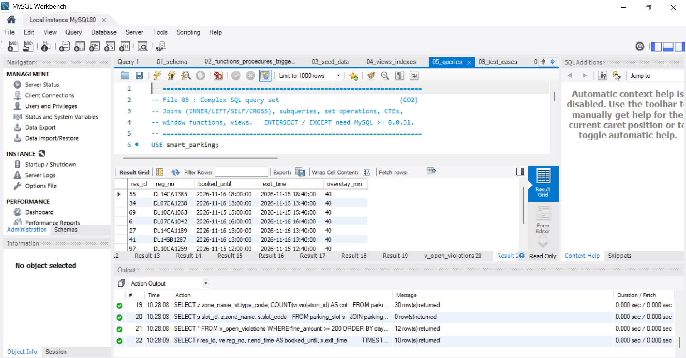

### SQL-injection prevention (file 07)
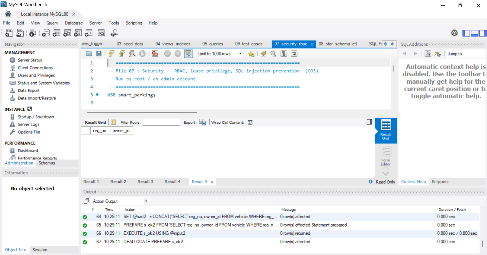

### Star schema and ETL (file 08)
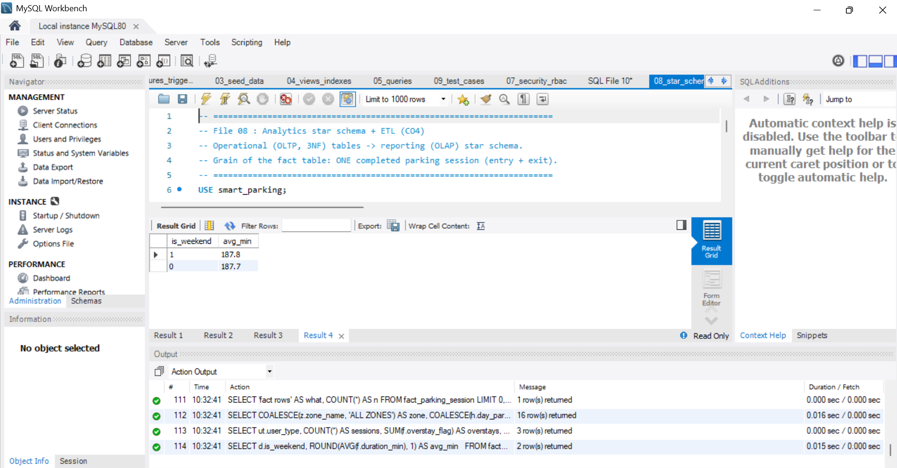

### Test cases (file 09)
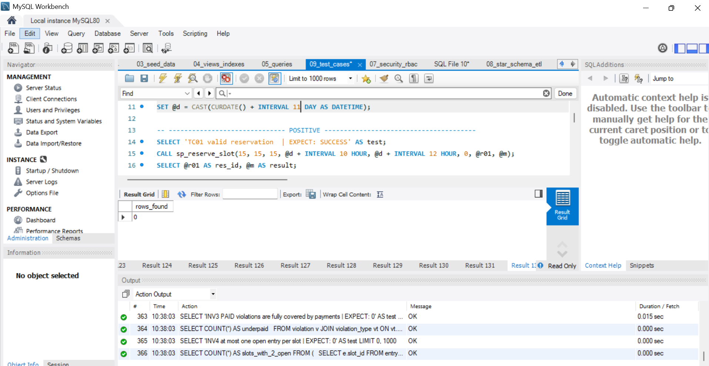

### Integrity invariants, all zero
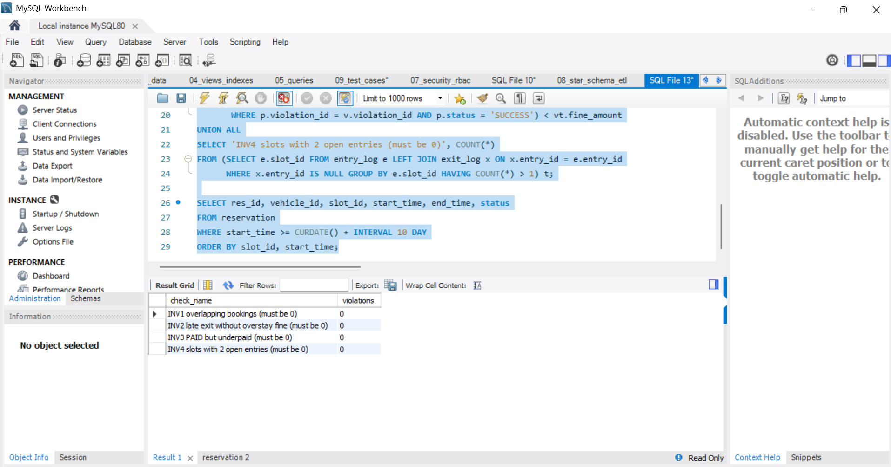

## Syllabus coverage

| Unit / CO | Covered by |
|---|---|
| Unit 1 / CO1 | ER/EER, keys, constraints, functional dependencies, 3NF/BCNF (report) |
| Unit 2 / CO2 | DDL/DML/DCL/TCL, all join types, subqueries, set operations, views, indexes, window functions, CTEs |
| Unit 3 / CO3 | ACID, COMMIT/ROLLBACK/SAVEPOINT, locking and deadlocks, procedures, functions, cursor, triggers, RBAC, SQL-injection prevention |
| Unit 4 / CO4 | MongoDB collection with aggregation, star schema + ETL, Python application integration |